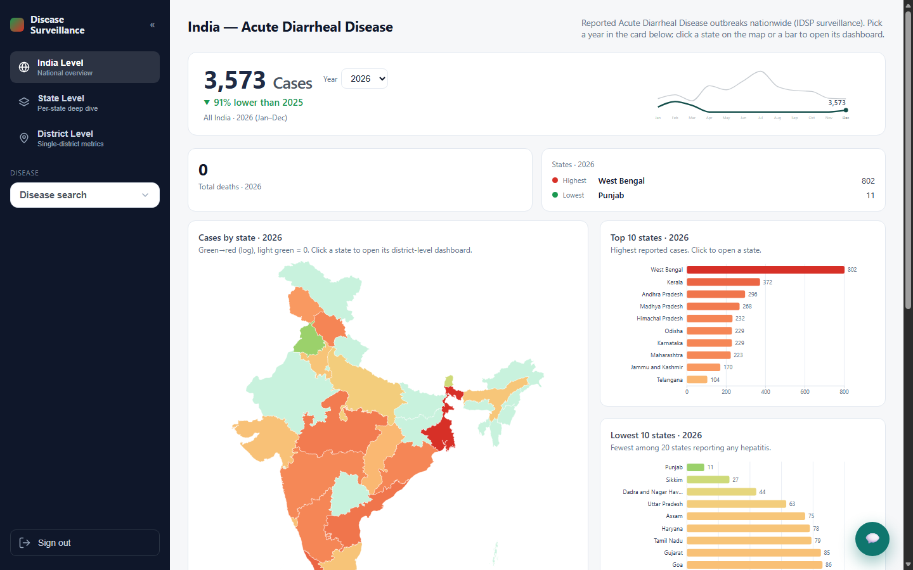
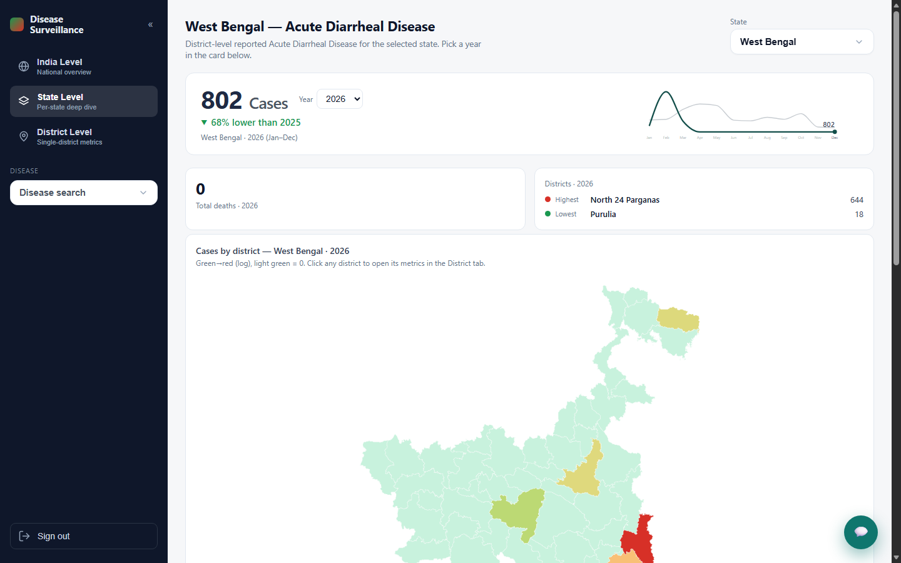

# IDSP disease surveillance: forecastability and dashboard

Code and dashboard behind our Telemedicon 2026 abstract on India's Integrated Disease Surveillance Programme (IDSP) outbreak data.

> **Forecastability of routine outbreak surveillance data across administrative levels: comparing Prophet, SARIMA and linear models on weekly IDSP reports, 2009-2026**
> Krishna Praharshitha Devi Kota and Renuka Prasanthi Dandi. Submitted to Telemedicon 2026, Jaipur (Track 5: Predictive Analytics, Digital Public Health and Population Health Management).



## What we found

We took 44,952 aggregate IDSP outbreak records from 2009 to 2026, removed duplicates, and built monthly case series at national, state and district level for the ten highest-burden diseases. A series was modelled only if it had at least 24 populated months across a 48-month span. Prophet, SARIMA(1,1,1)(1,1,1,12) and ordinary least squares were each fitted on everything except the last twelve months and scored on that holdout by weighted absolute percentage error (WAPE).

| Level | Series that qualified | Linear | SARIMA | Prophet |
|---|---|---|---|---|
| National | 10 of 20 | 76.9% | 82.8% | 76.8% |
| State | 99 of 700 | 100.0% | 110.5% | 104.9% |
| District | 63 of 12,800 | 105.5% | 123.5% | 113.9% |

*Median WAPE on the 12-month holdout. Lower is better.*

- Forecast error rose with granularity for every model.
- A plain linear trend matched or beat both seasonal models at every level, winning outright on 45 of 99 state series.
- On 72 of 172 series (42%), even the best model was off by more than 100%.

Our reading is that reporting completeness, not the choice of algorithm, is what limits forecasting. Routine IDSP reporting doesn't currently support district-level forecasting, so data readiness should be reported alongside model accuracy before predictive surveillance tools are deployed. Outbreak notifications also aren't incidence data, so these series understate the true burden.

The Prophet, SARIMA and linear comparison isn't included in this repository. It holds the data pipeline and the dashboard.

## The dashboard

A React and D3 app for exploring the outbreak data by disease, at three levels:

- **India:** state choropleth, the 10 highest and 10 lowest states, and yearly cases with a 2-year forecast
- **State:** the same views for the districts of one state
- **District:** metrics for a single district

It covers the 16 diseases with more than 10,000 reported cases. The forecast chart uses Holt's linear trend with an approximate 80% band, which is separate from the models in the abstract. There's also an optional chatbot that answers questions about the data through the Groq API.



## Run it

**Dashboard** (needs Node.js):

```bash
cd frontend
npm install
cp .env.example .env    # optional: add a Groq API key for the chatbot
npm run dev             # http://127.0.0.1:5173
```

The demo sign-in is `idsp@admin` / `admin123`. It's checked in the browser and is only a placeholder. Don't treat it as access control.

**Data pipeline** (needs Python 3.11+):

```bash
python -m venv .venv
.venv\Scripts\activate          # macOS/Linux: source .venv/bin/activate
pip install -r requirements.txt
python src/clean_data.py               # raw spreadsheet -> data/processed/idsp_clean.csv
python src/shp_to_geojson.py           # district shapefile -> data/processed/india_districts.geojson
python src/export_frontend_data.py     # writes frontend/public/data/
```

`src/forecast_hepatitis.py`, `src/visualize.py` and `src/visualize_hepatitis.py` produce the exploratory reports in `reports/`.

## Data

The pipeline needs three inputs that aren't stored here, because of their size or redistribution terms:

| File | Put it in | Source |
|---|---|---|
| IDSP master dataset (xlsx) | `data/raw/` | Ministry of Health and Family Welfare, compiled by Dataful: https://dataful.in/datasets/18514. Original weekly reports: [IDSP](https://idsp.mohfw.gov.in/index4.php?lang=1&level=0&linkid=406&lid=3689) |
| District boundaries (`in_district.*`) | `data/raw/india_shp_2020/` | [abhatia08/india_shp_2020](https://github.com/abhatia08/india_shp_2020) (MIT), from [India Official Boundaries 2019](https://github.com/justinelliotmeyers/India_Official_Boundaries_2019) |
| State boundaries (`India_State_Boundary.*`) | `data/raw/india_state_2020/` | Anuj Tiwari, India State and Country Shape File (Jan 2020) |

The aggregated outputs the dashboard reads are included in `frontend/public/data/`, so the app runs without the raw files. Boundaries follow the Government of India's official depiction.

## Keep the API key out of builds

Vite embeds any `VITE_` variable into the built JavaScript. If you run `npm run build` with a real `VITE_GROQ_API_KEY` in `.env`, the key ends up in `dist/` and anyone can read it. Build without the key before deploying. Users can paste their own key into the chatbot instead, and it's stored only in their browser.
